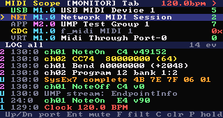
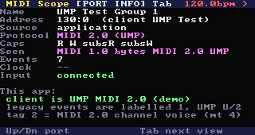
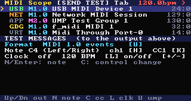

# MIDI Scope

A MIDI monitor for the Cardputer Zero (320x170 LCD, keyboard only). It lists the MIDI ports with their kind and MIDI version, shows a live decoded event log, and sends test messages.
Everything goes through the ALSA sequencer: connections stay up and ports that appear later are followed.

  

## Screens

Tab switches between three views: **Monitor** (port rows and the event log), **Port info** and **Send test**.

A port row shows the kind (`USB`, `GDG` gadget, `VRT` virtual, `NET` network, `APP`, `HW`), the version (`M1.0` MIDI 1.0, `U1.0` UMP carrying MIDI 1.0, `M2.0` MIDI 2.0), the name and an event count (`*` active, `x` muted).
Log lines are tagged `1` (classic MIDI 1.0 event), `U` (UMP) or `2` (MIDI 2.0 channel voice); MIDI 2.0 values are shown in full resolution. MIDI clock is counted, not logged, and a BPM estimate shows in the title bar.

| Keys | |
| --- | --- |
| Monitor | Up / Down port, `Enter` mute / unmute, `F` only the selected port, `C` clear, `P` hold, PgUp / PgDn scroll |
| Send test | Up / Down output, `N` or `Enter` note, `C` control change (`K` picks the number), `H` channel, `U` MIDI 1.0 / UMP, `L` clock, `+` / `-` tempo, Left / Right note |
| hold `Esc` | quit |

MIDI 2.0 is detected because MIDI Scope is itself a UMP client: each event arrives in the form its source sent it, and a port is marked by its source's declared MIDI version.

## Build

```sh
tools/build.sh                        # arm64 .deb in out/ (Debian 13 container; runs the unit tests)
midi-scope --ascii --demo [--keys tab,down,...]   # the layout as text, without hardware
midi-scope-testsrc m1|m2 [seconds]    # synthetic MIDI 1.0 / UMP sources (installed with the app)
```

Install with `sudo dpkg -i midi-scope_0.1.1_arm64.deb`; "MIDI Scope" appears in the launcher. It depends on `libasound2t64 (>= 1.2.10)`.

## License

MIT, see [LICENSE](LICENSE). `third_party/font8x8_basic.h` is public domain.

Made by Leo Kuroshita ([@kurogedelic](https://github.com/kurogedelic)).
